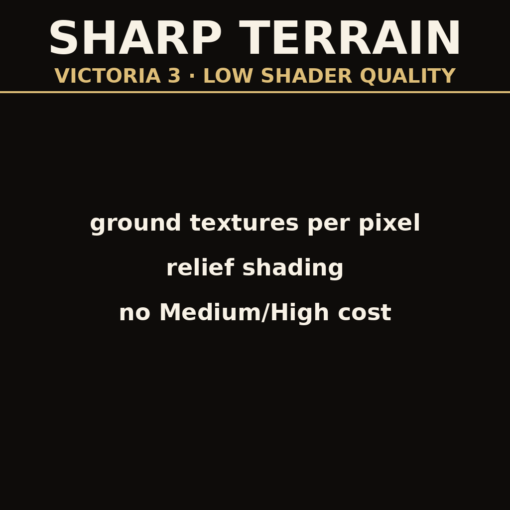

# Sharp Terrain on Low Shader Quality (Victoria 3)

Restores per-pixel ground textures and gives the map its relief back when the graphics
option **Shader Quality** is set to **Low**. Vanilla Low turns the whole map into a
blurry, flat-lit watercolour, regardless of the texture settings.

The Victoria 3 counterpart of
[Sharp Terrain Without Advanced Shaders](https://github.com/mekedron/ck3-lowspec-terrain-fix)
for Crusader Kings III: the same engine, the same cause.

## Cause

It is not a texture streaming or texture quality problem. With Shader Quality on Low
the map is drawn with `Effect PdxTerrainLowSpec` from `game/gfx/FX/pdxterrain.shader`,
and that effect does the detail texture work in the **vertex** shader
(`game/gfx/FX/lowspec_terrain.fxh`):

    VS_OUTPUT_PDX_TERRAIN_LOW_SPEC TerrainVertexLowSpec( ... )
    {
        ...
        CalculateDetailsLowSpec( Vertex.WorldSpacePos.xz, Out.DetailDiffuse, Out.DetailMaterial );
        Out.ColorMap = PdxTex2DLod0( ColorTexture, ... ).rgb;
        Out.Normal   = CalculateNormal( Vertex.WorldSpacePos.xz );
    }

`DetailDiffuse`, `DetailMaterial` and `ColorMap` are then interpolated across each
terrain triangle, so the effective ground resolution is the density of the terrain
mesh, not the resolution of the textures. They are sampled at mip 0 once per vertex
and smeared.

On top of that, `PixelShaderLowSpec` does no lighting at all. The vertex shader
computes the terrain normal and the pixel shader never uses it, so hills, ridges and
mountain ranges are only visible through their textures.

The Medium/High `PixelShader` calls `CalculateDetails()` per pixel and runs the full
PBR lighting with shadows and a cubemap, which is why those settings look sharp and
cost so much more.

## Fix

`gfx/FX/pdxterrain.shader` is a copy of the vanilla file with one new pixel shader,
`PixelShaderLowSpecSharp`, and the two low spec effects rewired to it:

    Effect PdxTerrainLowSpec       VertexShaderLowSpec      -> VertexShader
                                   PixelShaderLowSpec       -> PixelShaderLowSpecSharp
    Effect PdxTerrainLowSpecSkirt  VertexShaderLowSpecSkirt -> VertexShaderSkirt
                                   PixelShaderLowSpec       -> PixelShaderLowSpecSharp

`PixelShaderLowSpecSharp` follows the vanilla low spec pixel shader line by line,
with three changes:

* `CalculateDetails()` per pixel, with `ddx`/`ddy` driven mip selection, instead of
  the per-vertex `CalculateDetailsLowSpec()`; colormap and flatmap sampled per pixel too
* **relief shading**: the terrain normal, reoriented by the detail normal maps
  `CalculateDetails()` samples anyway, dotted with the sun direction and divided by
  what flat ground gets. Flat ground keeps exactly the vanilla Low brightness, slopes
  facing the sun get lighter and slopes facing away get darker, clamped to 0.45-1.25
* the paper map's folds, grid lines and equator are drawn while the map blends to the
  flat map, as on Medium/High; vanilla Low skips them, so they pop in at the end

Because the effects now use the plain `VertexShader`, the per-vertex detail sampling
is gone, which pays back part of the added pixel cost.

Everything that makes Medium/High expensive stays off: no shadow map, no cubemap
lighting, no specular, no harvest condition, pollution or devastation materials.
Water, rivers, trees, buildings and units keep their vanilla Low versions.

## Options

At the top of the `PixelShader` Code block in `gfx/FX/pdxterrain.shader`:

    #define SHARPOPT_RELIEF_SHADING     hills shaded by the sun direction
    #define SHARPOPT_DETAIL_NORMALS     detail normal maps take part (free)
    #define SHARPOPT_FLATMAP_OVERLAY    paper map folds and lines while zooming out

    #define SHARP_RELIEF_STRENGTH 0.65  0 = flat, 1 = full Lambert relative to flat ground
    #define SHARP_RELIEF_MIN 0.45       darkest a slope can get
    #define SHARP_RELIEF_MAX 1.25       brightest a slope can get

Comment a line out or change a number, re-run `install.sh` and restart the game.

## Layout

    .metadata/metadata.json       mod metadata
    thumbnail.png                 Workshop preview, must sit in the mod root
    gfx/FX/pdxterrain.shader      the mod
    install.sh                    copies the mod into the Proton prefix
    tools/compile_check.py        DXC compile check against the game's shader cache
    tools/check_log.sh            mount and shader error check after a game start
    tools/bbcode_to_plain.py      Paradox Mods texts from the Steam ones
    steam-workshop/               listing texts and the thumbnail generator

## Installing

Run `./install.sh`. It copies the mod into the Victoria 3 mod directory inside the
Proton prefix, which exists after the game has been started once. Then add the mod to
the playset in the launcher and set Shader Quality to Low in the game. The first map
load is slower while the shader compiles.

## Verifying without starting the game

    tools/compile_check.py --dxc <extracted linux_dxc release>

It takes a cached Medium/High terrain pixel shader entry from the game's shader cache
(any game start with Shader Quality on Medium or High leaves them), swaps in
`PixelShaderLowSpecSharp` and compiles it with DXC to SPIR-V, with and without the
flatmap blend and with each option off. DXC: the `linux_dxc_*.tar.gz` asset of a
[DirectXShaderCompiler release](https://github.com/microsoft/DirectXShaderCompiler/releases).

After a game start, `tools/check_log.sh` reports whether the mod was mounted and any
shader compile error.

## Game version

Built against Victoria 3 1.13.11. Shader overrides replace the vanilla file wholesale,
so a patch that reworks `pdxterrain.shader` needs an update here.

## Multiplayer / achievements

Graphics only: no gameplay, script or history files are changed, and the mod is not
multiplayer synchronized, so it can be added or removed at any time.
